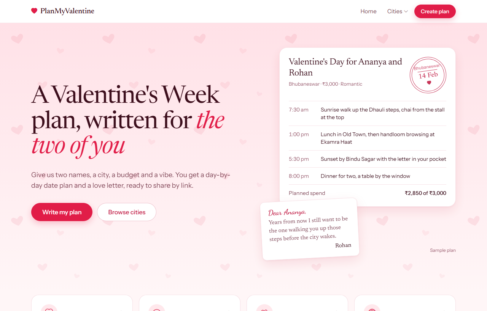
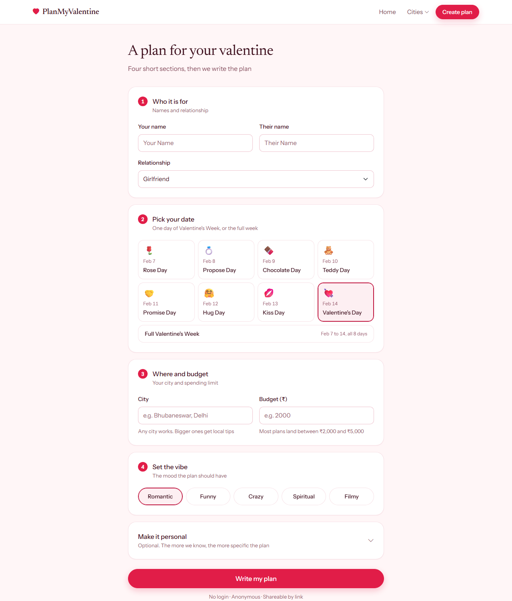
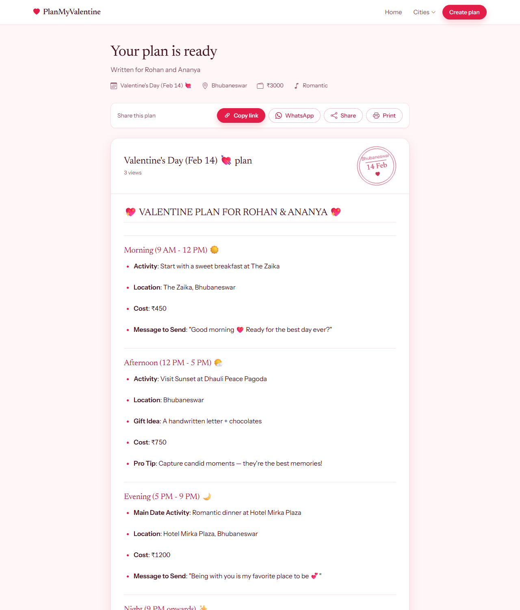
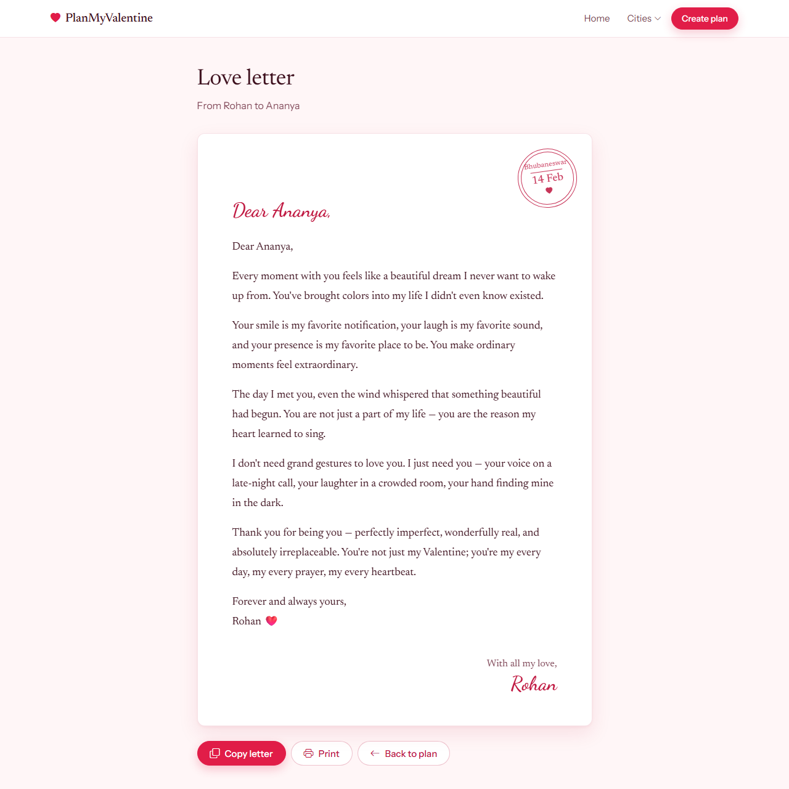
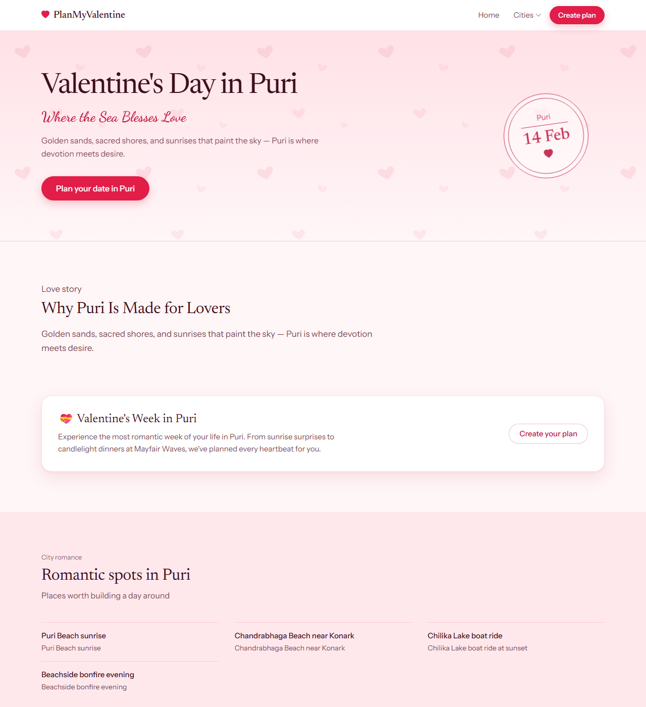

# PlanMyValentine

**Personalized Valentine's Week date plans and love letters, made in a few minutes.**



PlanMyValentine turns a few thoughtful details into a date plan that feels like it belongs to two real people. Enter names, a city, a budget, a date, and a vibe. The app creates a practical plan you can share by link, plus an optional letter written from the same story.

## A look at the product

The screenshots below use sample names (Rohan and Ananya) and the built-in fallback content, so they show what the app produces without an OpenAI key.

### 1. Tell it who, when, where and the vibe

One form, four short sections: who the plan is for, which day of Valentine's Week, the city and budget, and the mood. An optional "Make it personal" section takes details about the person and your story.



### 2. Get a plan you can share

The result page lays the day out from morning to night with places, costs and messages to send. From here the creator can copy the link, share on WhatsApp, print, write a matching love letter, or switch on confession mode to hide their name.



### 3. Add a love letter

A letter is written from the same details as the plan and can be copied or printed.



### 4. Browse Valentine's ideas by city

Each city page has a romantic introduction, suggested spots and stays, a sample morning-to-night date, and a letter from the city, with a button to start a plan there.



## What is PlanMyValentine?

PlanMyValentine is a free, no-login Valentine's planning app built with Django. It helps someone answer questions such as:

- What can we do for Valentine's Day in our city?
- How can I plan a romantic date within my budget?
- What is a thoughtful Valentine's Week idea for my crush or best friend?
- How can I create a self-love day that feels intentional?
- How can I share a surprise plan without revealing my name?

The experience is designed to be useful before the surprise and shareable after it.

## Highlights

- **Personalized plans** based on names, relationship, city, budget, date, vibe, and optional context.
- **Four ways to start**: a valentine, a crush, a best friend, or yourself.
- **Nine date choices**: Rose Day through Valentine's Day, or the complete eight-day week.
- **AI-assisted writing** through OpenAI when an API key is configured.
- **Reliable fallback content** when OpenAI is unavailable or not configured.
- **City-aware suggestions** for romantic places, cafés, activities, stays, and date ideas.
- **Shareable result pages** with copy-link, native sharing, WhatsApp, and print actions.
- **Confession mode** for sharing a plan anonymously and revealing the sender later.
- **Reactions** so recipients can respond to a shared plan.
- **Personalized love letters** generated from the plan details.
- **No account required** for creating or sharing a plan.
- **A rose-pink Valentine theme** with a responsive Bootstrap-based interface.

## How it works

1. **Choose the occasion**  
   Start with a valentine, crush, friend, or self-love plan.

2. **Tell us the essentials**  
   Add names, relationship type, city, budget, date, and vibe. Optional fields let you describe the person, your story, or a special request.

3. **Get a plan**  
   Django sends the details to the plan generator. OpenAI creates the copy when configured; otherwise the built-in city-aware fallback keeps the experience working.

4. **Make it yours**  
   Review the result, generate a matching love letter, or turn on confession mode.

5. **Share the surprise**  
   Send the result by link, WhatsApp, native device sharing, or a printed page. Recipients can leave a reaction.

## Supported planning options

### Relationship types

- Girlfriend
- Boyfriend
- Crush
- Best friend
- Self-love

### Valentine's Week dates

- Rose Day — February 7
- Propose Day — February 8
- Chocolate Day — February 9
- Teddy Day — February 10
- Promise Day — February 11
- Hug Day — February 12
- Kiss Day — February 13
- Valentine's Day — February 14
- Full Valentine's Week — February 7 to 14

### Vibes

- Romantic
- Funny
- Crazy
- Spiritual
- Filmy

## City experiences

The home page groups city pages into Odisha cities, metro cities, and romantic getaways. Each city landing page can include:

- A city-specific romantic introduction
- Suggested romantic spots
- A sample morning-to-night date plan
- Local places, cafés, activities, and stays
- A city-inspired love letter
- A direct call to create a plan for that location

The city catalogue is maintained in [`core/prompts.py`](core/prompts.py). The app currently includes a broad set of Indian destinations, with especially detailed coverage for Odisha.

## Tech stack

- **Python 3.8+**
- **Django 4.2**
- **SQLite** for local development
- **OpenAI Python SDK** for optional AI generation
- **python-dotenv** for environment variables
- **Bootstrap 5** and Bootstrap Icons
- **Server-rendered Django templates**
- **Vanilla JavaScript** for sharing, clipboard actions, form helpers, and city suggestions

## Run locally

### 1. Create a virtual environment

PowerShell:

```powershell
python -m venv .venv
.venv\Scripts\activate
```

### 2. Install dependencies

```powershell
python -m pip install -r requirements.txt
```

### 3. Configure the environment

Copy the example file:

```powershell
Copy-Item .env.example .env
```

Then edit `.env`:

```dotenv
OPENAI_API_KEY=your_openai_api_key_here
SECRET_KEY=replace-this-in-production
DEBUG=True
```

`OPENAI_API_KEY` is optional for local exploration. Without it, the application uses its built-in fallback plan, letter, and city content.

### 4. Apply migrations

```powershell
python manage.py migrate
```

### 5. Start the development server

```powershell
python manage.py runserver
```

Open [http://127.0.0.1:8000/](http://127.0.0.1:8000/).

On Windows, [`start.bat`](start.bat) can activate `.venv`, apply migrations, and start the server in one step.

## Main URLs

| URL | Purpose |
| --- | --- |
| `/` | Home page and city directory |
| `/planner/create/` | Create a plan |
| `/planner/result/<share-code>/` | Creator view of a plan |
| `/planner/share/<share-code>/` | Public share view |
| `/planner/letter/<share-code>/` | View a generated love letter |
| `/city/<city-slug>/` | City-specific Valentine experience |
| `/admin/` | Django admin |

Quick links can preselect a relationship type:

```text
/planner/create/?type=girlfriend
/planner/create/?type=crush
/planner/create/?type=best_friend
/planner/create/?type=self_love
```

## Project structure

```text
Valentine/
├── core/
│   ├── prompts.py       # AI prompts, fallback content, and city catalogue
│   ├── utils.py         # Share codes, formatting, and display helpers
│   ├── urls.py          # Home and city routes
│   └── views.py         # Home and city landing views
├── planner/
│   ├── models.py        # ValentinePlan, Reaction, and LoveLetter
│   ├── forms.py         # Planner and reaction validation
│   ├── views.py         # Create, share, react, letter, and anonymity flows
│   ├── urls.py          # Planner routes
│   ├── templatetags/    # render_plan filter that formats stored plan text safely
│   └── migrations/      # Database migrations
├── planmyvalentine/
│   ├── settings.py      # Django configuration
│   ├── urls.py          # Root URL configuration
│   ├── asgi.py          # ASGI entry point
│   └── wsgi.py          # WSGI entry point
├── templates/           # Base, home, form, result, share, letter, and city pages
├── static/
│   ├── css/style.css    # Visual design and responsive layout
│   └── js/main.js       # Client-side interactions
├── docs/screenshots/    # Images used in this README
├── manage.py
├── requirements.txt
└── .env.example
```

## Data model

The planner uses three application models:

- **ValentinePlan** stores the form inputs, generated plan, share code, view count, creator IP, and anonymous-sharing state.
- **LoveLetter** stores one optional letter associated with a plan.
- **Reaction** stores a recipient's selected reaction and optional IP address.

Local development uses `db.sqlite3`. That file is ignored by Git and should not be used as the primary database for production.

## Customization

### Add or update a city

Add a city entry to `CITY_SUGGESTIONS` in [`core/prompts.py`](core/prompts.py). A city record can provide:

```python
{
    "display_name": "Your City",
    "tagline": "A short romantic line",
    "romantic_desc": "A human introduction to the destination.",
    "state": "Your State",
    "places": ["Place 1", "Place 2"],
    "cafes": ["Cafe 1"],
    "activities": ["Activity 1"],
    "romantic_spots": ["A sunset idea"],
    "hotels": ["A stay"],
    "date_ideas": ["A date idea"],
    "hero_emoji": "💕",
}
```

### Change the site copy and SEO defaults

Shared metadata, the default title, Open Graph title, and Open Graph description live in [`templates/base.html`](templates/base.html). Page-specific titles are defined in the individual templates.

### Adjust the visual style

The layout and theme are in [`static/css/style.css`](static/css/style.css); colours, fonts and the heart pattern are defined as variables at the top of the file. Browser interactions are in [`static/js/main.js`](static/js/main.js).

### Tune generated content

The plan, love letter, and city experience prompts are in [`core/prompts.py`](core/prompts.py). The same module contains fallback generators so the app still has a useful path when an external AI request fails.

## Testing and useful commands

Run Django's built-in checks:

```powershell
python manage.py check
```

Check production warnings before deployment:

```powershell
python manage.py check --deploy
```

Create new migrations after model changes:

```powershell
python manage.py makemigrations
python manage.py migrate
```

Create an admin user when needed:

```powershell
python manage.py createsuperuser
```

Reset local database records while keeping the schema:

```powershell
python manage.py flush
```

## Production checklist

Before deploying, make sure you:

1. Generate a strong, private `SECRET_KEY`.
2. Set `DEBUG=False`.
3. Configure `ALLOWED_HOSTS` for the real domain.
4. Set `CSRF_TRUSTED_ORIGINS` for HTTPS domains when required.
5. Keep `OPENAI_API_KEY` and all secrets outside source control.
6. Replace SQLite with PostgreSQL or another managed production database.
7. Run `python manage.py collectstatic`.
8. Serve the app through a production WSGI or ASGI server.
9. Enable HTTPS and secure cookies.
10. Add backups, monitoring, rate limiting, and content-abuse protections.

The current development settings are intentionally simple and are not production-safe without these changes.

## FAQ

### Is PlanMyValentine free?

The application has no login or paid feature in this codebase. Running AI generation in production may still create OpenAI API costs, depending on your account and usage.

### Do I need an OpenAI API key?

No. The key is optional for local use. Without it, built-in fallback content generates plans, letters, and city experiences. With it, the app can request personalized content from OpenAI.

### Can I make a plan for someone besides a romantic partner?

Yes. The planner supports crushes, best friends, and self-love as well as girlfriend and boyfriend plans.

### Can I plan within a budget?

Yes. Budget is a required input and is included in the generated plan prompt. Treat suggested prices, venues, and availability as starting points and verify them before booking.

### Can I share a plan anonymously?

Yes. From the creator result page, enable confession mode before sharing. The public page hides the sender until the creator reveals them.

### Do users need an account?

No. A plan is created through one form and shared with a generated link. The app uses a session to recognize the creator's current plan for creator-only actions.

### Which cities are supported?

The app includes city-specific pages for many Indian destinations. Any city can still be entered in the planner; supported cities receive richer local suggestions.

## Contributing

Small, focused improvements are welcome:

1. Create a branch for your change.
2. Keep secrets and local databases out of commits.
3. Run `python manage.py check`.
4. Update directly related documentation.
5. Open a pull request with a clear description and screenshots for UI changes.

## License

No explicit license file is included yet. Add a license before distributing the project or accepting external contributions.

---

Built with Django, thoughtful prompts, and a little Valentine's Day magic.
